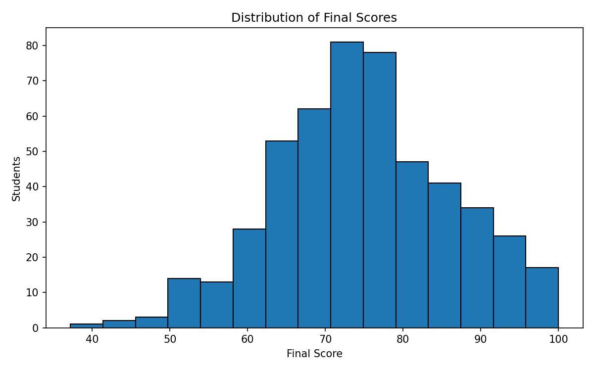
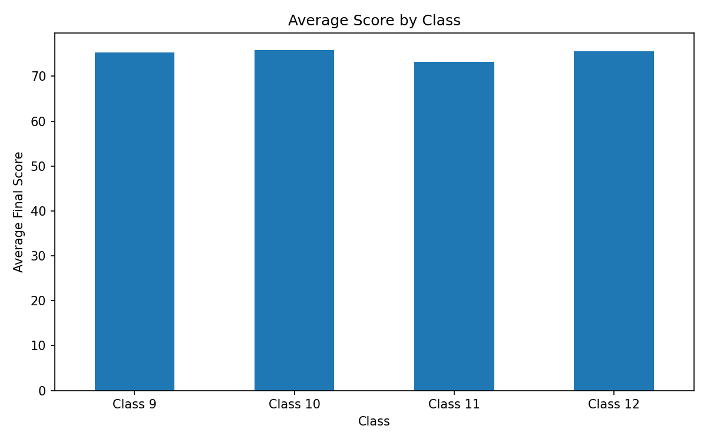
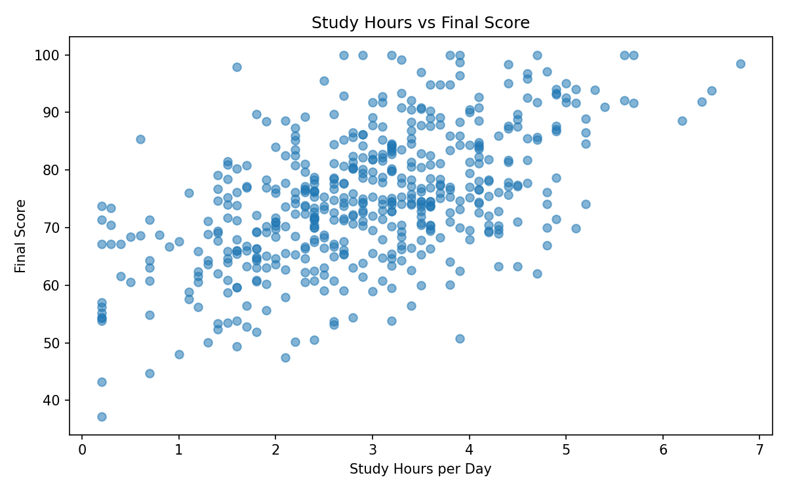

# Student Performance Analysis | Python

## Overview
A beginner-friendly data analysis project exploring how study hours, attendance, and selected student background factors relate to final scores.

> **Dataset notice:** The included 500-row dataset is synthetic and generated for portfolio practice. It contains no real student records.

## Objectives
- Inspect and validate a structured dataset.
- Calculate descriptive statistics.
- Compare score averages across classes and extra-tuition groups.
- Visualize score distributions and relationships.
- Explore correlations and explain their limitations.

## Tech Stack
Python, Pandas, NumPy, Matplotlib, Jupyter Notebook.

## Repository Structure
```text
student-performance-analysis/
├── data/student_performance.csv
├── notebooks/Student_Performance_Analysis.ipynb
├── src/analyze.py
├── reports/
│   ├── figures/
│   └── sample_findings.md
├── requirements.txt
├── .gitignore
└── README.md
```

## Dataset Columns
Student_ID, Class, Gender, Study_Hours_Per_Day, Attendance_Percent, Parent_Education, Internet_Access, Extra_Tuition, Final_Score.

## Setup (Windows)
```bash
git clone https://github.com/YOUR-USERNAME/student-performance-analysis.git
cd student-performance-analysis
python -m venv .venv
.venv\Scripts\activate
pip install -r requirements.txt
```

## Run
```bash
python src/analyze.py
```
Or launch the notebook:
```bash
jupyter notebook notebooks/Student_Performance_Analysis.ipynb
```

## Questions Explored
1. What is the distribution of final scores?
2. How do average scores vary across classes?
3. How are study hours associated with final scores?
4. How is attendance associated with final scores?
5. How do average scores differ between extra-tuition groups?

## Visualizations




## Responsible Interpretation
Correlation does not establish causation. Synthetic data cannot establish real-world student patterns. Do not use this analysis to rank or make high-stakes decisions about individual students.

## Resume Entry
**Student Performance Analysis | Python, Pandas, NumPy, Matplotlib**
- Analyzed 500 synthetic student records to explore score distributions, attendance, study habits, and class-level trends.
- Used Pandas and NumPy for data inspection, descriptive statistics, and group-wise analysis.
- Created visualizations with Matplotlib and interpreted correlations while documenting dataset limitations.

## Future Enhancements
- Build an interactive Streamlit dashboard.
- Add subject-wise scores and exam-term comparisons.
- Use an ethically sourced, anonymized dataset for a separate real-world analysis.
